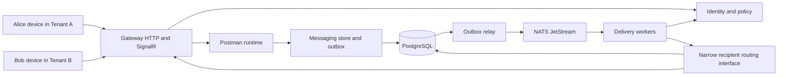

# Foundation architecture

This proposed architecture targets sealed one-to-one delivery between independently
authorized users in different tenants, even while the recipient is offline.
The provider would operate the shared network; devices would own encryption keys.
The diagram and flows below describe that target. See the
[repository README](../../README.md) for current implementation status.

The API modules share one deployable process. The worker host is separate.
Contracts may be shared; modules do not expose unrestricted database queries.
Infrastructure supplies adapters. The source dependency graph deliberately keeps
Identity, Postman and Messaging dependent only on Contracts until interfaces are
reviewed. The scaffold contains no database or broker adapters yet.

## Trust boundaries

1. Devices encrypt/decrypt and hold private keys; the provider receives ciphertext.
2. The gateway authenticates users and validates active tenant membership.
3. Postman invocations re-establish authority; a postman ID is not a credential.
4. Database transactions enforce the participant's tenant context with RLS.
5. The routing interface creates a separately authorized recipient record without
   exposing either tenant's conversation history to the other.
6. Operators and migrations use separately controlled privileges, never the
   ordinary runtime credential. Metadata access is scoped and audited.

## Delivery outline

Validate the sender and envelope, then commit ciphertext and outbox together.
Publish to JetStream asynchronously. A consumer rechecks authority and persists
recipient inbox state idempotently. SignalR may notify the recipient; HTTP sync
recovers lost notifications. An authorized device acknowledgment advances the
sender-visible delivery state. No provider component decrypts content.

The exact routing transaction, policy races, state machine and crypto binding
remain review items in [ADRs](../adr/README.md). The
[threat-model draft](../security/threat-model.md) records their security evidence.
