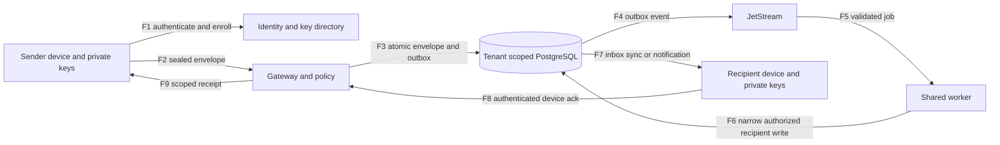

# F0 threat model

Status: Design review draft for F0.2. This expands the initial inventory into
trust boundaries, attack scenarios, controls and verification work. Runtime
controls remain proposed until implemented and tested; no residual risk has been
formally accepted and no production security approval is implied.

## Scope and security objectives

The Foundation supports one-to-one sealed messages across tenants, one active
device per user, a provider-operated single-region service, durable offline inboxes
and device acknowledgments. AI handlers, attachments, groups, multi-device sync
and cross-provider federation are excluded. The current implementation exposes
only process liveness; all messaging flows below describe the proposed design.

Objectives are tenant confidentiality, endpoint-only plaintext/key access,
authentic identity and receipt attribution, durable accepted messages, bounded
resource use, and auditable authorization. The provider sees routing metadata;
E2EE alone does not hide sender/recipient relationships, sizes or timing.

## Assets and actors

| Asset | Intended custody and visibility |
| --- | --- |
| Message plaintext and device private keys | Authorized device only; never delivery workers or provider message storage |
| Ciphertext, inbox and receipts | Participant-scoped records; routing service receives only the authority needed to deliver |
| Membership, grants and public keys | Trusted identity/policy and authenticated key directory; private views scoped to authorized actors |
| Routing metadata and audit | Participants and specifically authorized operators; minimized and retained by an explicit policy |
| Database, broker, OIDC and backup credentials | Separate runtime/operations identities with least privilege |
| Source, CI, hooks and agent credentials | Maintainer-controlled development environment; never untrusted PR execution |

Actors include honest users, a malicious user in either tenant, a compromised
recipient/sender device, stolen sessions, compromised workers or dependencies,
privileged operators, a malicious provider, and compromised coding/review agents.
A compromised endpoint can reveal its own plaintext. A malicious provider can
attempt public-key substitution or serve malicious web-client code. These are
explicit trust limitations, not solved by ciphertext storage.

## Data flows and trust boundaries

| Boundary | Required enforcement |
| --- | --- |
| Device to gateway | TLS, OIDC verification, active membership, envelope size/schema and rate limits; never trust declared sender/tenant |
| Public-key directory to device | Authenticated identity binding, key-change warnings and a reviewed first-contact/recovery model |
| Application to tenant data | Least-privileged non-BYPASSRLS roles, FORCE RLS, transaction-local tenant context; pooled connections reset correctly |
| Tenant to cross-tenant routing | Narrow capability/interface; separately authorized sender and recipient records; no unrestricted private-history reads |
| Broker to worker | Broker authentication, constrained subjects, authenticated job provenance and current policy checks |
| Provider to recipient device | Ciphertext integrity and sender binding verified on device; no plaintext logs |
| Device receipt to sender state | Authorized active device, matching delivery, atomic monotonic transitions and explicit late-event rules |
| Runtime to operations | Separate migration/restore roles, protected backups and scoped diagnostics; operator access audited |
| Repository/agent to maintainer credentials | Trusted hook sources, sandbox filesystem/network restrictions and no credentials in untrusted build/review jobs |

## Threat register

Severity describes impact before the proposed control is verified, not measured
likelihood. The evidence column is work to perform, not passing test evidence.

| ID | Attack and impact | Severity | Proposed control | Required verification and owner role |
| --- | --- | --- | --- | --- |
| T01 | Client forges tenant, user or postman to access another tenant | Critical | Server-derived identity and resource checks plus RLS | Forged claims/IDs and direct-query negatives; backend/security |
| T02 | Reused pooled connection carries the previous tenant context | Critical | Transaction-local context and role separation | Concurrent rollback/reuse tests with actual app pool/role; backend |
| T03 | Worker job injects another tenant or reuses private invocation state | Critical | Revalidate job authority; no persistent private worker context | Forged jobs, concurrent users and restart tests; delivery/security |
| T04 | Broad routing role reveals both tenants' histories | Critical | Narrow recipient write operation, participant-side records | Privilege matrix and forbidden reads; architecture/database |
| T05 | Provider swaps keys or serves malicious client code | Critical | Explicit endpoint/key trust, visible key changes, reviewed distribution | First-contact/rekey and client-distribution review; crypto/security |
| T06 | Endpoint or browser extension steals private keys/plaintext | Critical | Reviewed client storage and session lifecycle, minimal dependencies | Device-loss and compromise analysis; crypto/client |
| T07 | Ciphertext or envelope metadata is altered, replayed or misbound | High | Vetted protocol authentication plus bound identities/session metadata | Mutation, replay and wrong-recipient tests; crypto |
| T08 | Crash during persistence/publication loses an accepted message | High | Atomic outbox, durable storage and idempotent delivery | Crash injection before/after each commit/publication; delivery |
| T09 | Duplicate events/submissions create duplicate inbox state | High | Scoped idempotency, request digest and DB uniqueness | Same-key/different-payload and redelivery tests; backend/delivery |
| T10 | Attacker forges ack or late events regress state | High | Authorized recipient device and atomic transition rules | Wrong-device, duplicate, expiry race and reordering tests; delivery |
| T11 | Revoked capability still executes from queue | High | Current-policy recheck with explicit revocation boundary | Submission/queue/execution race tests; policy/security |
| T12 | One tenant exhausts storage, workers, connections or retries | High | Per-tenant quotas, bounded work, backpressure and fair scheduling | Noisy-neighbor/backlog/reconnect load; platform |
| T13 | Directory/error responses enumerate accounts or private relations | Medium | Narrow authorization, bounded responses and throttling | Lookup/error comparison and enumeration tests; API/security |
| T14 | Logs, traces, backups or support exports expose secrets/metadata | High | Redaction, minimization, role restrictions, explicit retention | Inspect synthetic telemetry and restore artifacts; platform/security |
| T15 | Operator or regional failure destroys message state | High | Protected backups, narrow admin access and rehearsed recovery | Define RPO/RTO and prove restore consistency; platform |
| T16 | Prompt injection or tool call reads/uploads developer credentials | Critical | Agent pre-tool guard plus OS-denied files, restricted environment/network, no secrets in workspace | Fake-file, symlink and tool-input tests; maintainer |
| T17 | Malicious PR/dependency alters CI/hooks or steals publication token | Critical | Pinned allowlisted actions, read-only jobs, no persisted Git token, manual policy diff review | Workflow lint, secret scan, token/permission review; maintainer |
| T18 | Author/agent bypasses PR review or merges a different commit | High | no-mistakes plus explicit exact-head review/merge process | Verify final head/checks; server enforcement unavailable on current plan; maintainer |

## Development controls already exercised

The shared agent guard is tested with synthetic payloads. The installed Codex
sandbox has been tested against a fake .env and a symlink. Native Codex hook trust
still requires the user; Claude integration is unverified because its CLI is absent.
See [agent safety](agent-safety.md) for exact coverage and limitations.

The owner requested keeping the private repository on its current plan. GitHub
branch protection remains unavailable, so T18 has no mandatory server-side
control. [Review and merge controls](review-and-merge.md) records actual settings
and the manual procedure. This constraint is not a production risk acceptance.

## Open decisions and release blockers

| ID | Decision/evidence needed | Accountable role | Exit condition |
| --- | --- | --- | --- |
| O01 | First-contact key verification, crypto library, client storage and recovery | Crypto/security reviewer not yet nominated | Reviewed F0.3 spike and recorded trust limitations |
| O02 | OIDC provider, membership lifecycle and administrative privileges | Maintainer/backend | Identity and privilege matrix reviewed in F0.4 |
| O03 | Cross-tenant routing interface and exact database privileges | Architecture/database reviewer | Forbidden operations enumerated and test design approved |
| O04 | Ack meaning, legal transitions, revocation and expiry races | Delivery/policy reviewer | Complete state machine and executable failure scenarios |
| O05 | Retention, quotas, abuse controls, audit access and recovery targets | Maintainer/platform | Written values/owners and F0.5 test plan |
| O06 | Independent reviewer, agent credential separation and enforced merge control | Maintainer | Real separation verified or a deliberate recorded limitation; no autonomous merge |

Role names are responsibility proposals, not assignments to unnamed people.
F0.2 is ready for design review when the maintainer confirms the flow/boundaries,
assigns accountable reviewers and accepts or resolves each open design question.
F0.2 review must be recorded separately from a code-scaffold merge. Runtime
security claims remain blocked on implementation and the verification evidence.
